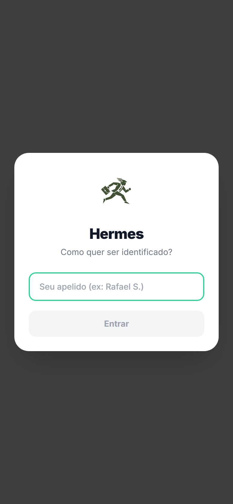
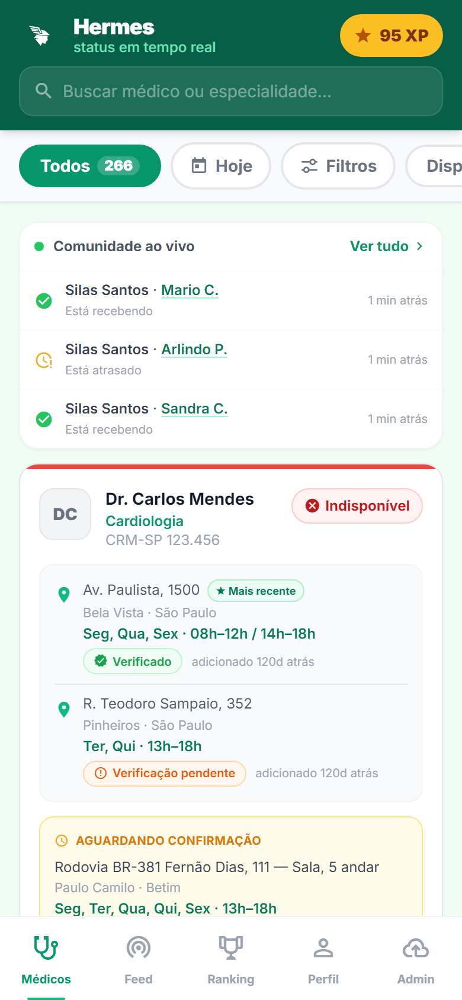
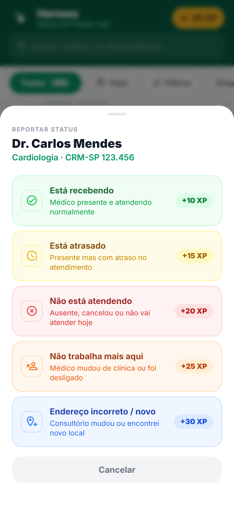
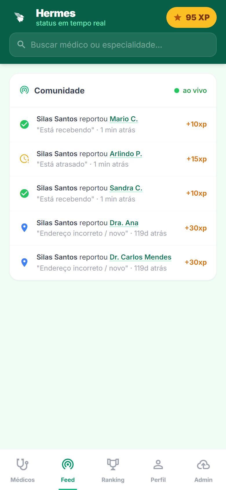
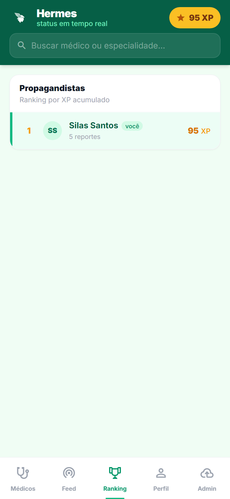

# Hermes

**Aplicativo colaborativo que mostra em tempo real onde um médico está atendendo e se vale a pena ir até lá.**

## Sobre o projeto

Propagandistas médicos perdem horas de trabalho visitando consultórios onde o médico está ausente, atrasado ou não atende naquele dia — e não existe hoje uma fonte de dados em tempo real que evite esse deslocamento às cegas. O Hermes resolve isso como uma inteligência coletiva de campo, no estilo Waze: cada propagandista reporta o status de atendimento do médico que acabou de visitar, e esse dado fica disponível na hora para todo o resto da equipe, com pontuação por contribuição para incentivar o uso.

Público-alvo: propagandistas e representantes de laboratórios farmacêuticos e distribuidoras de insumos médicos.

Status atual: MVP em produção, com 260 médicos reais importados de uma base Veeva/Salesforce e uso ativo em campo.

## Prévia

| | |
|---|---|
| **Identificação do usuário (apelido salvo localmente)** | **Lista de médicos com status, locais e atividade da comunidade** |
|  |  |
| **Painel de Ação Rápida — reportar status de atendimento** | **Feed da comunidade em tempo real** |
|  |  |
| **Ranking de propagandistas por XP acumulado** | |
|  | |

## Funcionalidades

### Mapeamento de médicos
- Lista de médicos com busca por nome ou especialidade e filtros rápidos (Todos, Disponíveis, Com Alertas, Hoje)
- Cada médico pode ter múltiplos locais de atendimento, com endereço, bairro, cidade, dias da semana, horário, telefone e secretaria
- Preenchimento automático de endereço por CEP (ViaCEP)

### Reporte colaborativo de status
- Cinco opções de reporte: recebendo, atrasado, não atendendo, mudou de local, endereço incorreto/novo
- Badge de status colorida (verde, amarelo, vermelho, laranja) atualizada em tempo real para todos os usuários
- Expiração automática de status após 12h sem novo reporte, e opção de desfazer um reporte feito por engano

### Confirmação por confiança
- Locais novos sugeridos por usuários com menos de 200 XP entram como "pendentes" até serem confirmados por outros propagandistas
- Usuários com 200+ XP podem adicionar um local já verificado diretamente

### Gamificação
- Pontuação (XP) por tipo de contribuição, com peso maior para reportes mais valiosos (ex: endereço novo vale mais que confirmar status)
- Ranking geral de propagandistas e perfil individual com histórico de contribuições

### Tempo real e PWA
- Atualizações via WebSocket (status de médico, novo reporte, confirmação, promoção de local) refletidas instantaneamente em todas as telas abertas
- Instalável como aplicativo (PWA), com ícone próprio, service worker e notificação sonora em eventos relevantes

### Importação de dados
- Upload de planilha XLSX exportada do Veeva/Salesforce, com pré-visualização de novos registros e duplicados antes de confirmar
- Normalização automática de CRM e extração de nome a partir de fórmulas de hyperlink da planilha

## Arquitetura e stack

| Camada | Tecnologia |
|---|---|
| Frontend | React 18 + Tailwind CSS (aplicação de página única, sem etapa de build) |
| Backend | FastAPI (Python 3.12) rodando sobre Uvicorn |
| Tempo real | python-socketio (WebSocket) |
| Banco de dados | PostgreSQL em produção, SQLite em desenvolvimento local, via SQLAlchemy 2.0 |
| Importação de dados | openpyxl, para leitura de planilhas Veeva/Salesforce |
| Hospedagem | Railway (backend, frontend estático e banco de dados) |

Quando um propagandista reporta o status de um médico pelo Painel de Ação Rápida, o frontend envia a requisição para a API do FastAPI, que grava o reporte no banco, atualiza o status do médico e o XP do usuário, e emite um evento via WebSocket para todos os clientes conectados — atualizando o card do médico, o feed da comunidade e o ranking em tempo real para qualquer outro usuário com o app aberto, sem necessidade de recarregar a página.

## Estrutura do projeto

```
hermes-app/
├── src/
│   ├── index.html          # Frontend completo (React + Tailwind, SPA sem build)
│   ├── sw.js                # Service worker (PWA)
│   ├── manifest.json        # Manifesto PWA
│   └── hermes-logo*.svg     # Identidade visual
├── backend/
│   ├── main.py               # API REST + WebSocket (FastAPI + Socket.IO)
│   ├── models.py              # Modelos SQLAlchemy (Medico, Local, Reporte, Usuario...)
│   ├── schemas.py              # Schemas Pydantic de entrada/saída
│   ├── database.py              # Conexão com o banco (Postgres em produção / SQLite local)
│   ├── importador.py             # Normalização de dados vindos do Veeva/Salesforce
│   ├── import_csv.py              # CLI de importação local
│   └── seed.py                     # Dados iniciais de demonstração
├── docs/                             # Documentação de planejamento e screenshots
├── requirements.txt
└── Procfile                           # Comando de start usado pelo Railway
```

## Como rodar localmente

Pré-requisitos: Python 3.12+ e pip. Não há etapa de build de frontend — o próprio backend serve o `index.html`.

```bash
git clone https://github.com/silassantos21/hermes-app.git
cd hermes-app
pip install -r requirements.txt

cd backend
python -m uvicorn main:app --reload --port 8000
```

Acesse `http://localhost:8000` no navegador. Sem variáveis de ambiente, o backend usa um banco SQLite local (`backend/medwaze.db`), criado automaticamente na primeira execução. Para apontar para um PostgreSQL, defina `DATABASE_URL` em um arquivo `.env` na raiz do projeto (veja `.env.example`).

| Serviço | Porta / endereço padrão |
|---|---|
| Backend + Frontend (FastAPI serve os dois) | `http://localhost:8000` |
| WebSocket (Socket.IO) | mesmo host e porta, em `/socket.io` |
| Banco de dados | SQLite local (`backend/medwaze.db`) ou PostgreSQL via `DATABASE_URL` |

---

Projeto em desenvolvimento ativo, com uso real em campo por propagandistas médicos.
